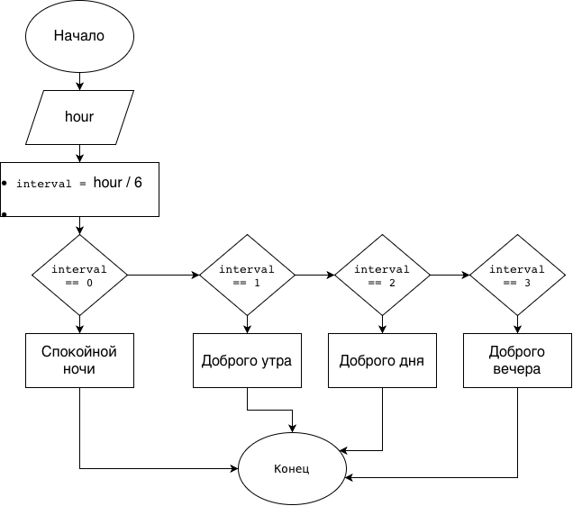

# Домашнее задание к работе 7

## Условие задачи
Записать программу, которая на ввод времени суток выводит соответствующее пожелание доброго утра, доброго дня, доброго вечера и спокойной ночи (с использованием оператора `switch`).

## 1. Алгоритм и блок-схема

### Алгоритм
1. **Начало**
2. Ввод значения часа (`hour`) с клавиатуры.
3. Вычисление интервала времени с помощью деления нацело: `hour / 6`.
4. С помощью оператора `switch` выбор сообщения:
   - Интервал `0` (0–5 ч) — `"Спокойной ночи"`
   - Интервал `1` (6–11 ч) — `"Доброго утра"`
   - Интервал `2` (12–17 ч) — `"Доброго дня"`
   - Интервал `3` (18–23 ч) — `"Доброго вечера"`
5. **Конец**

### Блок-схема
 

## 2. Реализация программы

```c
#include <stdio.h>

int main() {
    int hour;

    printf("Введите текущий час (от 0 до 23): ");
    scanf("%d", &hour);

    switch (hour / 6) {
        case 0:
            printf("Спокойной ночи\n");
            break;
        case 1:
            printf("Доброго утра\n");
            break;
        case 2:
            printf("Доброго дня\n");
            break;
        case 3:
            printf("Доброго вечера\n");
            break;
    }

    return 0;
}
```

## 3. Результаты работы программы

```text
Введите текущий час (от 0 до 23): 9
Доброго утра

Введите текущий час (от 0 до 23): 15
Доброго дня
```

## 4. Информация о разработчике

Цимбалист Костя бИЦТ-261
